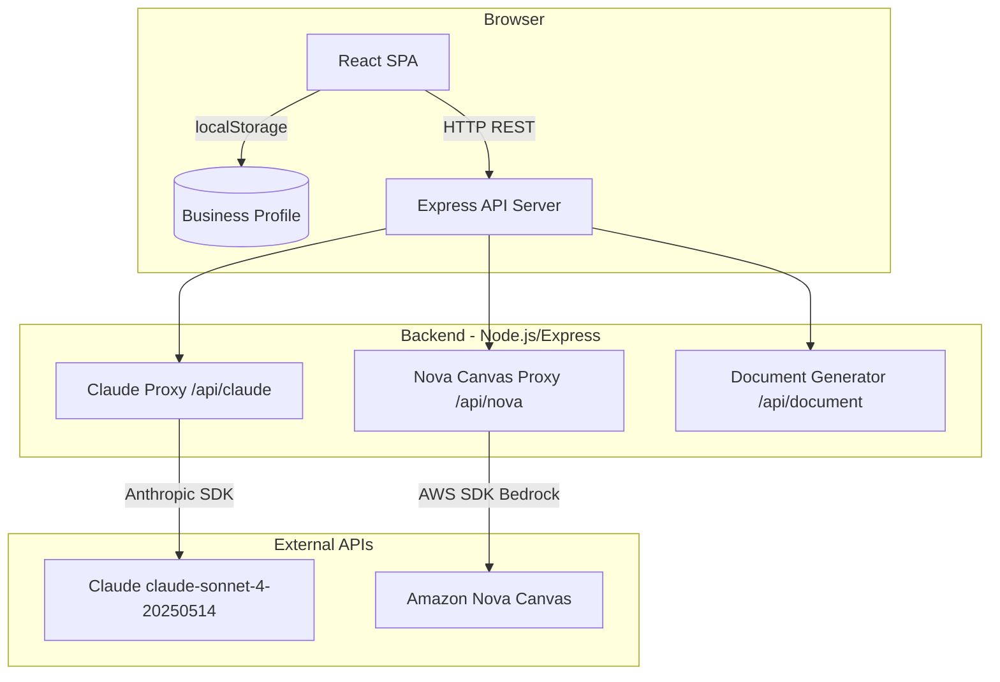

# Design Document: SMEwise AI Assistant

## Overview

SMEwise is a single-page web application (SPA) that provides AI-powered business guidance to Malaysian SME founders. The application is structured as a React frontend communicating with a Node.js/Express backend. The backend acts as a secure proxy for all AI API calls (Anthropic Claude and Amazon Nova Canvas via AWS Bedrock), ensuring API keys are never exposed to the browser.

The user flow is linear on first visit: fill in the Business Profile → receive an AI-generated Profile Summary Card → explore five unlocked Sections (Operations, Financial Planning, Pricing Strategy, Marketing, Owner Tools), each containing AI-powered Widgets.

---

## Design System

### Colour Palette

| Token | Hex | Usage |
|---|---|---|
| `bg-app` | `#0f0d1a` | Root page background |
| `bg-card` | `#1a1728` | Card and section panel backgrounds |
| `bg-input` | `#221f35` | Form input backgrounds |
| `border-default` | `#3d3660` | Default borders on cards and inputs |
| `accent-primary` | `#7c3aed` | Primary buttons, active states, left-border accents |
| `accent-highlight` | `#a78bfa` | Labels, highlights, hover text accents |
| `border-glow` | `#4c3d8f` | AI output card inner glow border |
| `placeholder` | `#6b6890` | Input placeholder text |

All colours are defined as CSS custom properties in `client/src/index.css` and extended in `tailwind.config.ts` so they are available as Tailwind utility classes (e.g., `bg-app`, `text-accent-highlight`).

### Typography

- Base font size: **15px** (set on `<html>` or `body`)
- Section headers: bold (`font-bold`), clearly separated with bottom margin
- Field labels: uppercase, 11px, letter-spacing `0.08em` — e.g., `text-[11px] uppercase tracking-widest text-accent-highlight`
- Body text: `text-sm` (14px) or `text-base` (15px) depending on context
- Monospace output (AI text): `font-mono text-sm` where applicable

### Spacing

- Card padding: `p-5` (20px)
- Section gap between cards: `gap-8` (32px)
- Form field gap: `gap-5` (20px)

### Cards and Sections

- Section panels: `bg-card rounded-xl border border-default p-5` with a `4px` left border accent in `accent-primary` (implemented via `border-l-4 border-l-[#7c3aed]`)
- AI output cards: `border border-[#4c3d8f]` with a subtle inner glow — `box-shadow: inset 0 0 0 1px #4c3d8f`
- All interactive elements: `transition: all 0.2s ease`
- Section cards on hover: `hover:-translate-y-0.5` (translateY -2px)

### Buttons

| Variant | Style |
|---|---|
| Primary (Generate) | `bg-[#7c3aed] text-white rounded-[10px] px-4 py-2 font-semibold hover:bg-[#6d28d9] transition-all` |
| Ghost (Regenerate) | `bg-transparent border border-[#7c3aed] text-[#a78bfa] rounded-[10px] px-4 py-2 hover:bg-[#7c3aed]/10 transition-all` |
| Loading state | Primary button with an inline spinner (CSS `animate-spin` border circle) replacing or preceding the label text |

### Form Inputs

- Border radius: `rounded-[10px]`
- Background: `bg-[#221f35]`
- Border: `border border-[#3d3660]`
- Focus ring: `focus:outline-none focus:ring-2 focus:ring-[#7c3aed]/27` (purple glow `box-shadow: 0 0 0 2px #7c3aed44`)
- Placeholder: `placeholder-[#6b6890]`
- Slider thumb: purple (`#7c3aed`) with a white ring — styled via custom CSS in `index.css`

### Loading and Progress States

- **Skeleton loader**: Pulsing `animate-pulse` placeholder blocks matching the expected content height of each Widget. Background `bg-[#3d3660]/40` with `rounded-lg`.
- **Global progress bar**: A thin `4px` bar at the very top of the page (`position: fixed; top: 0; left: 0; z-index: 9999`) in `#7c3aed`, animated with a CSS `@keyframes` slide from 0% to 100% width. Visible whenever any AI generation is in progress; hidden otherwise.

### Animations and Micro-interactions

- **Section unlock stagger**: When the Business Profile is submitted and the Dashboard unlocks, each `SectionPanel` fades in sequentially with a 100ms stagger delay. Implemented via inline `style={{ animationDelay: `${index * 100}ms` }}` and a `@keyframes fadeInUp` animation (opacity 0→1, translateY 16px→0).
- **Card hover lift**: `hover:-translate-y-0.5 transition-transform duration-200` on `SectionPanel` and `WidgetCard`.
- **Button loading spinner**: An `animate-spin` `<span>` (16px border circle, white border-top) rendered inside the button when `status === 'loading'`.

### Responsive Layout

| Breakpoint | Behaviour |
|---|---|
| `< 768px` (mobile) | All section cards stack to single column. Profile form collapses to 1-column. Sticky bottom tab bar for section navigation. |
| `≥ 768px` (tablet+) | Profile form renders as 2-column grid. Section cards use multi-column layout where appropriate. |
| `≥ 1280px` (desktop) | Full dashboard layout with sidebar or top nav. |

**Mobile sticky tab bar**: A `position: fixed; bottom: 0` bar with icon + label tabs for each of the 5 Sections. Visible only on `< 768px`. Tapping a tab scrolls to and expands the corresponding `SectionPanel`.

---

## Architecture



### Key Architectural Decisions

- **Backend-as-proxy**: All AI API calls are made server-side. The browser never receives or stores API keys.
- **No authentication**: MVP scope. Business Profile is persisted in `localStorage` only.
- **Streaming**: Claude text responses are streamed from the backend to the frontend using Server-Sent Events (SSE) or chunked transfer encoding.
- **Image generation**: Nova Canvas returns base64-encoded PNG images. The backend forwards the base64 string to the frontend, which renders it as a `` tag with a `data:image/png;base64,...` src.
- **Single-page layout**: All five Sections are rendered on one page with collapsible headers. No client-side routing is required.

---

## Components and Interfaces

### Frontend Component Tree

```
App
├── ProfileForm
│   ├── TextInput (Company Name, Industry, City, Target Customer, Goal)
│   ├── FundsInput (slider + numeric, RM-formatted)
│   ├── SelectInput (Business Stage, Business Type)
│   └── SubmitButton
├── ProfileSummaryCard
│   ├── StreamingText
│   ├── LoadingState
│   └── RegenerateButton
├── Dashboard (unlocked after profile submit)
│   ├── SectionPanel × 5
│   │   ├── SectionHeader (collapsible, GenerateAllButton)
│   │   └── WidgetCard × N
│   │       ├── LoadingState
│   │       ├── WidgetOutput (StreamingText | ImageDisplay | TableDisplay | ChatInterface)
│   │       ├── RegenerateButton
│   │       └── ErrorState (with RetryButton)
│   ├── PricingOptionalInputs (inside Pricing Strategy section)
│   └── DocumentGeneratorWidget (inside Owner Tools section)
│       ├── DocumentTypeDropdown
│       ├── FileUpload
│       ├── GenerateButton
│       └── DownloadButton (PDF / .docx)
└── BusinessChatbot (inside Owner Tools section)
    ├── MessageHistory
    ├── TypingIndicator
    └── MessageInput
```

### Backend Route Map

| Route | Method | Description |
|---|---|---|
| `POST /api/claude/stream` | POST | Streams a Claude text response (SSE) |
| `POST /api/claude/complete` | POST | Returns a complete Claude text response (JSON) |
| `POST /api/nova/image` | POST | Generates an image via Nova Canvas, returns base64 |
| `POST /api/document/generate` | POST | Generates a document using Claude Show_Reasoning mode |
| `GET /api/health` | GET | Health check; validates env vars are present |

### API Request/Response Shapes

#### `POST /api/claude/stream`
```json
// Request
{
  "systemPrompt": "string",
  "userMessage": "string",
  "temperature": 0.7,
  "tools": ["web_search"],   // optional
  "maxTokens": 1024
}
// Response: text/event-stream (SSE)
// data: {"delta": "partial text chunk"}
// data: [DONE]
```

#### `POST /api/nova/image`
```json
// Request
{
  "prompt": "string",
  "width": 1024,
  "height": 1024
}
// Response
{
  "imageBase64": "string",
  "mimeType": "image/png"
}
```

#### `POST /api/document/generate`
```json
// Request
{
  "documentType": "Business Plan Summary",
  "businessProfile": { /* BusinessProfile object */ },
  "templateText": "string | null"
}
// Response
{
  "content": "string",
  "thinkingSteps": "string | null"
}
```

---

## Data Models

### BusinessProfile

```typescript
interface BusinessProfile {
  companyName: string;          // required
  industry: string;             // required
  city: string;                 // required
  targetCustomer: string;       // required
  mainGoal: string;             // optional
  currentFunds: number;         // required, 1000–999999999
  businessStage: BusinessStage; // required
  businessType: BusinessType;   // required
}

type BusinessStage =
  | "Idea Stage"
  | "Just Launched"
  | "1–2 Years Operating"
  | "Established 3+ Years";

type BusinessType =
  | "Enterprise"
  | "Sdn Bhd"
  | "PLT"
  | "Sole Proprietorship"
  | "Partnership";
```

### PricingOptionalInputs

```typescript
interface PricingOptionalInputs {
  monthlyRevenueRange: string | null;  // dropdown value
  productServiceNames: string | null;  // textarea
  costPerProduct: string | null;       // textarea
}
```

### WidgetState

```typescript
type WidgetStatus = "idle" | "loading" | "success" | "error";

interface WidgetState {
  status: WidgetStatus;
  content: string | null;       // text output
  imageBase64: string | null;   // image output
  errorMessage: string | null;
}
```

### ChatMessage

```typescript
interface ChatMessage {
  id: string;
  role: "user" | "assistant";
  content: string;
  timestamp: number;
}
```

### localStorage Schema

```
Key: "smewise_business_profile"
Value: JSON.stringify(BusinessProfile)
```

---

## Prompt Engineering

Each Widget has a dedicated prompt template. All prompts share a common system prompt prefix:

```
You are SMEwise, an AI business advisor specialising in Malaysian SMEs.
Always use Malaysian context: RM currency, SSM/LHDN/EPF/SOCSO regulations,
Malaysian platforms (Shopee, Lazada, TikTok, WhatsApp Business, Google My Business),
and local financing (TEKUN, Cradle, MDEC, MIDA, MBAN, MaGIC, pitchIN).
Never use USD or reference non-Malaysian regulations.
When including URLs, use the web_search tool to verify they are live before including them.
Omit any URL you cannot verify.
```

Widget-specific prompts inject the relevant `BusinessProfile` fields and any optional inputs. Word limits are enforced via the prompt instruction (e.g., "Respond in 200 words or fewer.").

---

## Correctness Properties

*A property is a characteristic or behavior that should hold true across all valid executions of a system — essentially, a formal statement about what the system should do. Properties serve as the bridge between human-readable specifications and machine-verifiable correctness guarantees.*

### Property 1: Business Profile round-trip persistence

*For any* valid `BusinessProfile` object, serialising it to JSON and saving it to `localStorage`, then reading it back and deserialising it, SHALL produce an object that is deeply equal to the original.

**Validates: Requirements 1.7, 24.1, 24.2, 24.4**

### Property 2: Funds slider and input synchronisation

*For any* numeric value within the valid range (1,000 – 999,999,999), setting the slider to that value SHALL cause the numeric input to display the same value, and setting the numeric input to that value SHALL cause the slider to reflect the same position.

**Validates: Requirements 1.3**

### Property 3: Required field validation completeness

*For any* `BusinessProfile` submission where one or more required fields are empty or missing, the form SHALL reject the submission and display at least one inline validation error — one per missing required field.

**Validates: Requirements 1.5**

### Property 4: Widget error state on API failure

*For any* Widget and any simulated API failure (network error, 4xx, 5xx, timeout), the Widget SHALL transition to an error state displaying a non-technical message and a visible retry button, and SHALL NOT remain in a loading state indefinitely.

**Validates: Requirements 4.8, 5.6, 6.7, 7.7, 8.6, 9.7, 10.9, 12.7, 13.7, 14.5, 15.8, 16.5, 17.5, 18.10, 19.7, 23.1, 23.2**

### Property 5: RM currency formatting consistency

*For any* numeric monetary value produced by any Widget or displayed in the UI, the rendered string SHALL match the pattern `RM [0-9,]+(\.[0-9]{2})?` (e.g., `RM 1,200.00` or `RM 50,000`).

**Validates: Requirements 1.3, 7.3, 9.3, 13.3, 15.3, 22.4**

### Property 6: Chatbot response word cap

*For any* user message sent to the Business Chatbot, the assistant response SHALL contain no more than 200 words.

**Validates: Requirements 19.3**

---

## Error Handling

### Frontend Error Handling

- Each `WidgetCard` maintains its own `WidgetState`. On API error, `status` is set to `"error"` and `errorMessage` is populated.
- The `ErrorState` component renders a friendly message (e.g., "Something went wrong. Please try again.") and a `RetryButton` that re-triggers the last generation call.
- Rate limit responses (HTTP 429) display: "Our AI service is busy right now. Please wait a moment and try again."
- Network timeout errors display: "The request timed out. Please check your connection and retry."
- `localStorage` failures are caught with `try/catch`; a non-blocking toast notification informs the user that profile saving is unavailable.

### Backend Error Handling

- All route handlers are wrapped in `try/catch`. Errors are logged with context (route, timestamp, sanitised request body — no API keys).
- HTTP 500 responses include a `{ "error": "string" }` body with a user-safe message.
- Missing environment variables at startup cause the process to exit with a descriptive log message (Requirement 21.4).
- Anthropic SDK and AWS SDK errors are caught and mapped to appropriate HTTP status codes before forwarding to the client.

---

## Testing Strategy

### Unit Tests

- `BusinessProfile` serialisation/deserialisation (round-trip)
- Form validation logic (required fields, funds range, dropdown values)
- RM currency formatting utility function
- Prompt builder functions (verify correct fields are injected)
- `WidgetState` reducer (idle → loading → success/error transitions)
- Chatbot word-count enforcement

### Property-Based Tests

Property-based testing is applied to the pure logic layer using a library such as **fast-check** (TypeScript/JavaScript).

- **Property 1**: Generate random `BusinessProfile` objects, serialise to JSON, deserialise, assert deep equality.
- **Property 2**: Generate random fund values in [1000, 999999999], set slider, assert input sync; set input, assert slider sync.
- **Property 3**: Generate `BusinessProfile` objects with one or more required fields set to empty string, assert form rejects and error count ≥ number of empty required fields.
- **Property 4**: For each Widget type, simulate API failure, assert Widget reaches error state with retry button visible.
- **Property 5**: Generate random monetary values, pass through the RM formatter, assert output matches `RM [0-9,]+(\.[0-9]{2})?`.
- **Property 6**: Generate random user messages, mock Claude to return responses of varying lengths, assert all responses ≤ 200 words.

Each property test runs a minimum of **100 iterations**.

Tag format: `// Feature: smewise-ai-assistant, Property N: <property_text>`

### Integration Tests

- Backend `/api/claude/stream` with a mocked Anthropic SDK: verify SSE chunks are forwarded correctly.
- Backend `/api/nova/image` with a mocked Bedrock client: verify base64 image is returned.
- Backend `/api/health`: verify returns 200 when all env vars are set, 500 when any are missing.
- Frontend `ProfileForm` submit: verify `localStorage` is written and Sections are unlocked.
- Frontend `localStorage` restore: verify pre-populated form and unlocked Sections on page load.

### Snapshot / Visual Tests

- `ProfileSummaryCard` rendered with a known `BusinessProfile` — snapshot test.
- `WidgetCard` in each state (idle, loading, success, error) — snapshot tests.
- `BusinessChatbot` with a seeded message history — snapshot test.
